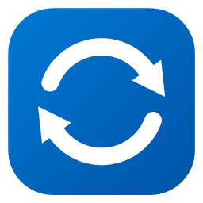
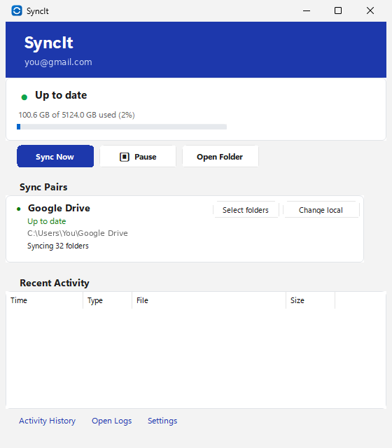
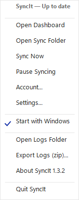
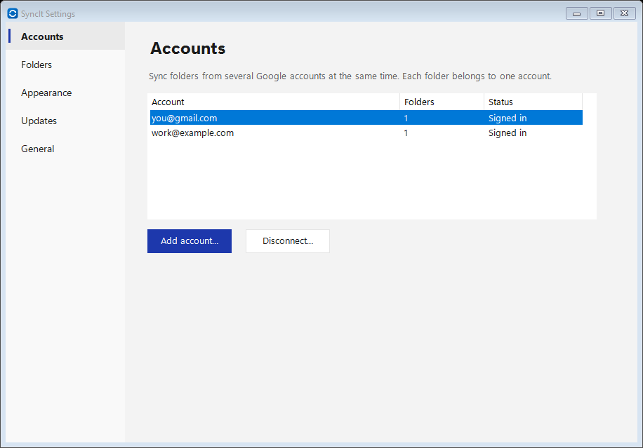
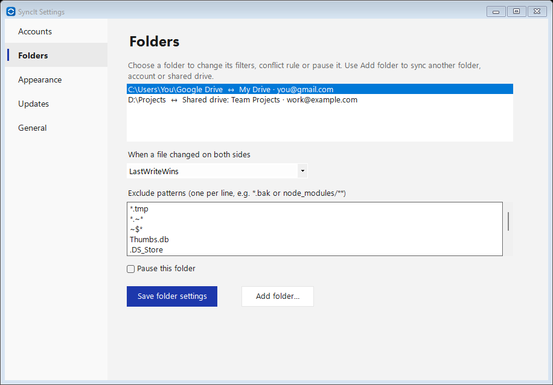
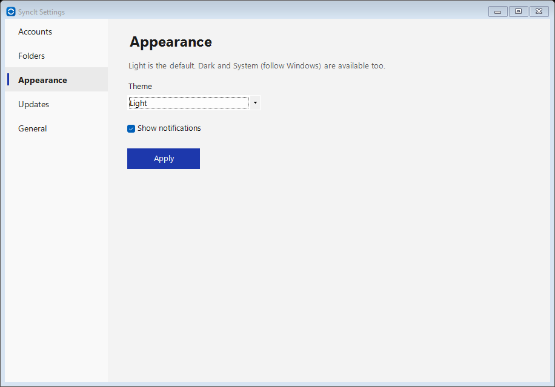
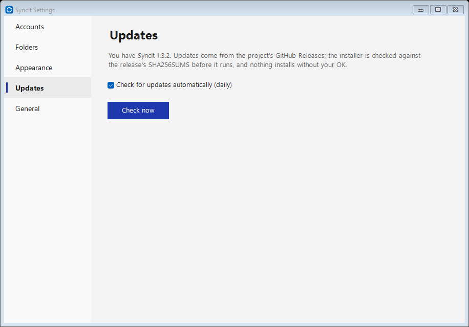
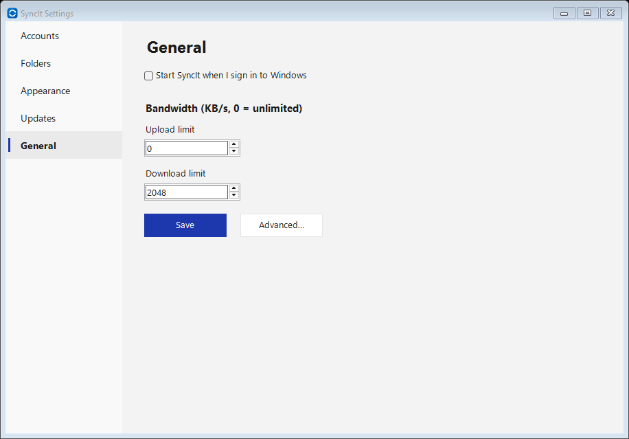
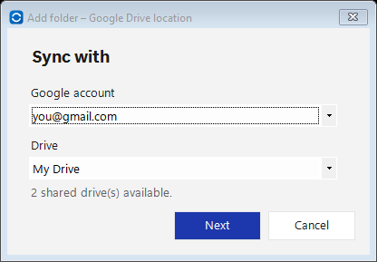
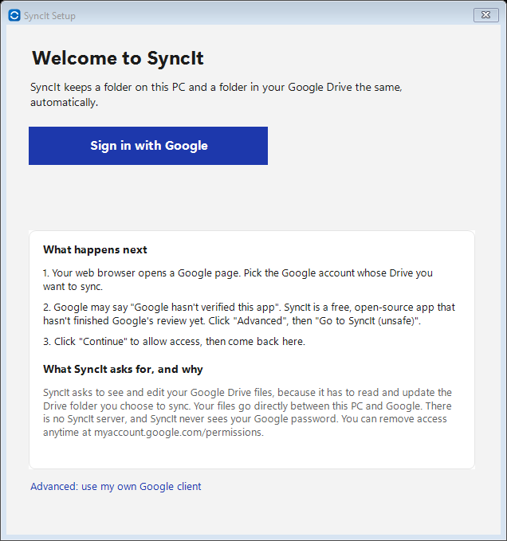

# SyncIt

A lightweight, bidirectional Google Drive sync tool for Windows. Keep a local folder in sync with Google Drive — simple, reliable, and fully under your control.

<p align="center"></p>

| Dashboard | Tray menu |
|---|---|
|  |  |

| Settings → Accounts (several accounts at once) | Settings → Folders (filters, conflict rule, pause) |
|---|---|
|  |  |
| **Settings → Appearance** | **Settings → Updates** |
|  |  |
| **Settings → General (startup, bandwidth)** | **Add folder → account and drive** |
|  |  |

| Sign-in |
|---|
|  |

## Features

- **Multiple Google accounts at once** — add several accounts (Settings → Accounts); every sync folder belongs to one account, each account has its own DPAPI-encrypted sign-in and its own Disconnect
- **Shared drives** — sync a shared drive (Team Drive) with a local folder; pick it when you add a folder
- **Auto-update** — checks GitHub Releases daily, tells you in the tray, downloads the installer, verifies it against the release's `SHA256SUMS` and installs only when you click OK (can be turned off)
- **Settings window** — accounts, folders (exclude patterns, conflict rule, pause per folder), appearance (light by default, dark, follow Windows), updates, start with Windows, upload/download bandwidth limits
- **Bidirectional sync** — local changes upload instantly via FileSystemWatcher; remote changes download via periodic polling
- **Large file streaming** — files >5 MB stream directly to disk with resumable uploads and progress tracking
- **Conflict resolution** — four configurable policies: LastWriteWins, KeepBoth, PreferLocal, PreferRemote
- **Deletion safety** — three-layer protection with baseline verification, grace period, and threshold freeze before any file is removed
- **Explorer integration** — sync status icons (✓ synced / ↻ syncing) in Windows Explorer via the Cloud Files API
- **Robust sync** — no duplicate uploads (looks up existing Drive files first), real renames incl. case-only, waits for files still being written, skips temp/lock files, Unicode (NFC/NFD) and long-path safe, automatic recovery from expired change tokens, rate-limit backoff
- **Selective sync** — choose specific Drive subfolders; filter files with glob-based include/exclude patterns
- **Google Docs export** — auto-convert Docs → .docx, Sheets → .xlsx, Slides → .pptx, Drawings → .svg
- **Windows 11 look** — Fluent-style windows and tray menu, light/dark that follows Windows, your accent color, rounded corners, crisp high-DPI icons
- **Support tools** — tray menu: About (version), Open Logs Folder, Export Logs (zip with tokens/secrets/emails redacted); crash reports written to the logs folder
- **System tray UI** — icon states, account info, storage bar, recent activity, and detailed status window
- **Secure credentials** — OAuth2 tokens encrypted with DPAPI; client secrets stored in Windows Credential Manager

## Why SyncIt vs Google Drive for desktop

Google Drive for desktop is the right choice for most people. SyncIt is for people who want plain local folders, explicit control and safety rails. Only capabilities that work in the current release are listed.

| | SyncIt | Google Drive for desktop |
|---|---|---|
| Sync **any local folder** (one or many) with Drive | ✅ each folder is its own sync pair | Mirrors My Drive into one location; other folders are backed up as "Computers" |
| Files are **plain local copies**, always offline | ✅ always | Streaming (on-demand) by default; mirroring optional |
| **Several Google accounts** at the same time | ✅ (no fixed limit) | ✅ up to 4 |
| **Shared drives** | ✅ sync a shared drive with a local folder | ✅ (streamed) |
| **Conflict rule per folder** (LastWriteWins, KeepBoth, PreferLocal, PreferRemote) | ✅ | Automatic; no per-folder choice |
| **Exclude patterns** (`*.bak`, `node_modules/**`, …) per folder | ✅ | ❌ |
| **Deletion safety**: grace period, mass-delete freeze that waits for your approval, local trash, deletion journal | ✅ | Deletes sync through (Drive trash only) |
| Docs/Sheets/Slides **exported to .docx/.xlsx/.pptx** so they open offline in Office | ✅ | Shortcut files that open in the browser |
| Explorer status icons | ✅ | ✅ |
| Bandwidth limits | ✅ | ✅ |
| Portable (no install) option | ✅ portable zip | ❌ |
| Open source (MIT), no SyncIt server | ✅ | ❌ |
| Google Photos, streaming/virtual drive, macOS | ❌ | ✅ |

Limits to know: Windows only; no streaming mode; the built-in sign-in is not verified by Google yet, so Google shows an "unverified app" screen and limits new users (the optional own-client setup avoids both).

## Windows SmartScreen warning

SyncIt releases are not code-signed yet, so the first time you run the installer Windows may show **"Windows protected your PC"**. Click **More info → Run anyway**.

Every release includes a `SHA256SUMS` file. To check a download before running it:

```powershell
Get-FileHash .\SyncIt-<version>-setup.exe -Algorithm SHA256
```

The hash must match the line for that file in `SHA256SUMS` on the release page. SyncIt's built-in auto-update does this check for you and refuses an installer that does not match.

## Install

1. Download `SyncIt-<version>-setup.exe` (installer, no admin needed) or the portable zip from [Releases](https://github.com/madmike30/syncit/releases), or build it with `publish.bat`.
2. Put it anywhere and double-click it. No .NET install needed.
3. Click **Sign in with Google**, approve in your browser, and pick the local and Drive folders. See [docs/SETUP-GOOGLE-OAUTH.md](docs/SETUP-GOOGLE-OAUTH.md). Technical users can optionally use their own Google client (Advanced link).
## Requirements

- Windows 10 or 11
- Release: no .NET installation required
- Development only: [.NET 8.0 SDK](https://dotnet.microsoft.com/download/dotnet/8.0)

## Quick start

### Development

```bash
dotnet run --project SyncIt.App
```

### Release build

```bash
publish.bat          # creates the standalone ./publish/SyncIt.exe (~100 MB, compressed)
```

### First run

1. Double-click `SyncIt.exe`
2. Click **Sign in with Google**
3. Approve access in the browser
4. Choose your local sync folder and Drive folder
5. The tray icon appears — syncing begins

## Architecture

```
SyncIt.sln
├── SyncIt.Core/        Core library — models, services, safety
├── SyncIt.App/         Unified single-process app (sync engine + tray icon)
└── SyncIt.Tests/       xUnit test suite (157 tests)
```

Single-process architecture like OneDrive / Google Drive: sync engines run on background threads, tray icon on the WinForms UI thread. No child processes, no IPC.

## Configuration

All data lives under `%APPDATA%\SyncIt\`:

| File | Purpose |
|------|---------|
| `syncit.json` | Sync pairs and settings (hot-reloads on save) |
| `token.bin` | DPAPI-encrypted OAuth2 refresh token |
| `state.db` | SQLite file baseline state |
| `delete-journal.db` | Deletion audit log |
| `logs/` | Rolling logs (7-day retention) |

See [docs/CONFIGURATION.md](docs/CONFIGURATION.md) for the full config reference, or [docs/syncit.example.json](docs/syncit.example.json) for an annotated example.

## Documentation

- [Architecture](docs/ARCHITECTURE.md) — components, data flow, design decisions
- [User Guide](docs/USER-GUIDE.md) — quickstart, menu walkthrough, troubleshooting
- [Configuration](docs/CONFIGURATION.md) — complete settings reference
- [Test Plan](docs/TEST-PLAN.md) — QA test matrix
- [Google OAuth setup](docs/SETUP-GOOGLE-OAUTH.md) — sign-in, plus optional own-client setup
- [Maintainer: Google Cloud setup](docs/GOOGLE-CLOUD-SETUP-FOR-MAINTAINER.md) — built-in client, limits, verification
- [Roadmap](docs/ROADMAP.md) — what's next
- [Releasing](docs/RELEASING.md) — tags, draft releases, signing options
- [Privacy Policy](docs/PRIVACY.md) · [Terms of Use](docs/TERMS.md)
- [Security](SECURITY.md) — credential storage and reporting issues

## Tech stack

- **C# / .NET 8.0** — Windows desktop (WinForms for tray UI)
- **Google.Apis.Drive.v3** — Drive API client
- **Microsoft.Data.Sqlite** — file state storage (WAL mode)
- **Polly** — retry policies for resilient API calls
- **Serilog** — structured logging
- **Windows Cloud Files API** — Explorer status column integration

## License

[MIT](LICENSE) - Copyright (c) 2026 SyncIt contributors
