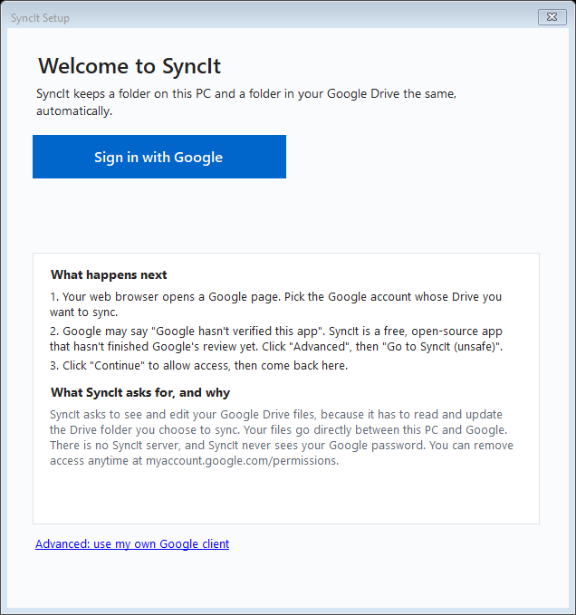
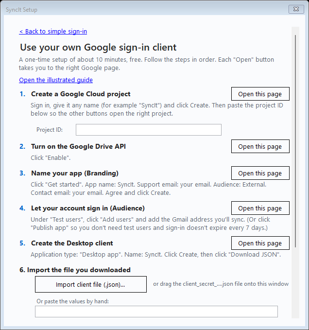

# Connecting SyncIt to Google

## The easy way (most people)



1. Click **Sign in with Google**. Your web browser opens.
2. Choose the Google account whose Drive you want to sync.
3. You may see **"Google hasn't verified this app"**. SyncIt is free and open source and is still waiting for Google's review. Click **Advanced**, then **Go to SyncIt (unsafe)**.
4. Click **Continue** to allow access. Go back to SyncIt and click **Continue**.

**What SyncIt asks for:** permission to see and edit your Google Drive files. It needs this to read and update the folder you choose to sync. Files go straight between your PC and Google. There's no SyncIt server, and SyncIt never sees your password. You can remove access anytime at <https://myaccount.google.com/permissions>.

**If sign-in is blocked.** If Google says the app has reached its user limit or is blocked, SyncIt shows an **Advanced: use my own Google client** link. Follow the optional steps below.

> The easy way needs a release that includes SyncIt's built-in client (official releases). Self-built copies without it open the advanced setup instead.

## Optional, for technical users: your own Google client (about 10 minutes, free)

Most people never need this. It's for builds without the built-in sign-in, or if Google limits the shared sign-in.



In SyncIt, click the small **Advanced: use my own Google client** link. Each step has an **Open this page** button that opens the right Google page for you.

| # | Step | What to click |
|---|---|---|
| 1 | **Create a project** ([open](https://console.cloud.google.com/projectcreate)) | Name it `SyncIt`, click **Create**. Copy the **Project ID** into SyncIt so the next buttons open that project. |
| 2 | **Turn on the Drive API** ([open](https://console.cloud.google.com/apis/library/drive.googleapis.com)) | Click **Enable**. |
| 3 | **Branding** ([open](https://console.cloud.google.com/auth/branding)) | Click **Get started**. App name `SyncIt`, your email as support email, Audience **External**, your email as contact, then agree and **Create**. |
| 4 | **Audience** ([open](https://console.cloud.google.com/auth/audience)) | Under **Test users**, click **Add users** and add your Gmail address. Or click **Publish app**, so you don't need test users and sign-in doesn't expire after 7 days. |
| 5 | **Create the client** ([open](https://console.cloud.google.com/auth/clients/create)) | Application type **Desktop app**, name `SyncIt`, then **Create** and **Download JSON**. |
| 6 | **Import** | In SyncIt, click **Import client file (.json)** or drag the `client_secret_....json` file onto the window. SyncIt checks that it's a *Desktop app* client. You can also paste the Client ID and Secret by hand. |
| 7 | **Sign in** | Click **Sign in with Google** and follow the browser, as in the easy way. |

### Optional: let a script do steps 1-2
If you have the [Google Cloud CLI](https://cloud.google.com/sdk/docs/install) installed, run:

```powershell
powershell -ExecutionPolicy Bypass -File scripts\setup-google-client.ps1
```

It creates the project, enables the Drive API, then opens steps 3-5 in your browser with the project already selected. Google doesn't provide a supported command for the consent screen or for creating a Desktop OAuth client on a personal account, so those steps stay in the browser.

### Troubleshooting
| What you see | What to do |
|---|---|
| "Access blocked" / `access_denied` | Add your account under **Test users** (step 4), or publish the app. |
| "This is a Web application client" | Create a new client with type **Desktop app**. |
| `invalid_client` | Download the JSON again and import it. You may have mixed up the ID and the secret. |
| "Google Drive API has not been used" | Do step 2. |
| Asked to sign in again every 7 days | Your app is in *Testing*. Click **Publish app** on the Audience page. |

## Why the full Drive permission?
SyncIt asks for one scope: `https://www.googleapis.com/auth/drive`. The narrower `drive.file` only shows files that SyncIt created itself. SyncIt syncs **existing** folders and files that other devices add, so with `drive.file` those would be invisible and sync would break.

## Where your sign-in is stored
A custom Client ID/Secret goes in Windows Credential Manager. Your sign-in token is saved to `%APPDATA%\SyncIt\token.bin`, encrypted with Windows DPAPI. See [SECURITY.md](../SECURITY.md).
